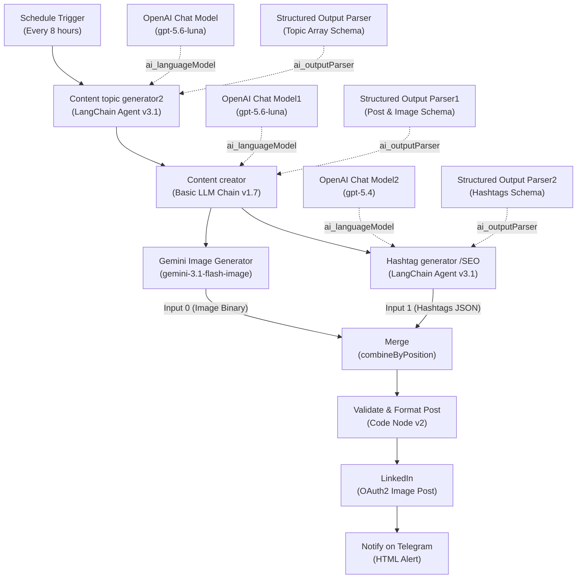

# AI-Powered LinkedIn Content Automation

[](https://n8n.io/)
[](https://platform.openai.com/)
[](https://ai.google.dev/)
[](https://learn.microsoft.com/en-us/linkedin/)
[](https://core.telegram.org/bots/api)
[](LICENSE)
[](https://github.com/nijjukrr/AI-Powered-LinkedIn-Content-Automation/actions/workflows/ci.yml)

> An end-to-end, multi-agent n8n automation pipeline that researches student- and early-career-focused LinkedIn topics, writes structured post copy, generates custom realistic visuals via Google Gemini, optimizes SEO hashtags in parallel, publishes to LinkedIn, and sends instant Telegram delivery alerts.

---

## Table of Contents

1. [Project Introduction](#1-project-introduction)
2. [Problem Statement](#2-problem-statement)
3. [Project Objectives](#3-project-objectives)
4. [Proposed Solution](#4-proposed-solution)
5. [Key Features](#5-key-features)
6. [Technology Stack](#6-technology-stack)
7. [System Architecture](#7-system-architecture)
8. [Workflow Execution Sequence](#8-workflow-execution-sequence)
9. [Detailed Node Explanation](#9-detailed-node-explanation)
10. [Installation Instructions](#10-installation-instructions)
11. [n8n Workflow Import Instructions](#11-n8n-workflow-import-instructions)
12. [API Credential Configuration](#12-api-credential-configuration)
13. [LinkedIn Integration Instructions](#13-linkedin-integration-instructions)
14. [Example Workflow Input and Output](#14-example-workflow-input-and-output)
15. [Screenshots](#15-screenshots)
16. [Testing and Verification Instructions](#16-testing-and-verification-instructions)
17. [Limitations](#17-limitations)
18. [Future Improvements](#18-future-improvements)
19. [Interview & Engineering Deep Dive](#19-interview--engineering-deep-dive)
20. [Author Information](#20-author-information)

---

## 1. Project Introduction

**AI-Powered LinkedIn Content Automation** is a 15-node, multi-stage [n8n](https://n8n.io/) workflow designed to automate the complete lifecycle of a LinkedIn post—from topic ideation to copywriting, image generation, SEO hashtag optimization, deterministic validation, publishing, and notification.

Unlike monolithic single-prompt scripts, this project decomposes content creation into specialized AI agents and LangChain chains connected via **Structured Output Parsers**. This ensures deterministic JSON contracts between stages, enables parallel execution for visual and SEO asset generation, and cleanly assembles the final payload for the LinkedIn OAuth2 API.

> **Note on Workflow Naming:** The original n8n export carries the legacy title *"Automated LinkedIn content creation with GPT-4 and DALL-E for scheduled posts"*, which reflects the original template name (`templateId: 4968`). In the actual exported implementation (`workflows/linkedin_content_automation.json`), the pipeline uses **OpenAI Chat Model** nodes (`gpt-5.6-luna` and `gpt-5.4`), **Google Gemini** (`models/gemini-3.1-flash-image` / Nano Banana 2) for image generation, and **Telegram** for post-publish alerts.

---

## 2. Problem Statement

Maintaining a consistent, high-value presence on LinkedIn—especially for college students, fresh graduates, and early-career builders—requires:

- **Consistent ideation** across relevant themes (internships, placements, portfolios, AI tools, networking) without repeating generic advice.
- **Structured copywriting** with strong hooks, readable formatting, and clean separation between body text and hashtags.
- **Visual assets** tailored to the post topic rather than generic stock photos.
- **SEO discoverability** through balanced broad, niche, and trending hashtags.
- **Reliable scheduling and confirmation** without manual copy-pasting across multiple tools.

Doing this manually every day is time-consuming and prone to inconsistency.

---

## 3. Project Objectives

- Automate scheduled LinkedIn content generation on an **8-hour interval** using n8n's `Schedule Trigger`.
- Enforce **typed JSON schemas** at every LLM boundary using `@n8n/n8n-nodes-langchain.outputParserStructured` so downstream nodes never break on free-form text.
- Decouple **copywriting**, **image generation**, and **hashtag SEO** into specialized nodes and parallel branches.
- Sanitize and normalize post content and hashtags dynamically using n8n expressions before publishing via the LinkedIn API.
- Provide immediate **observability** after publishing via a formatted Telegram notification containing the post title, LinkedIn URN link, and IST timestamp.
- Document the architecture, security posture, failure modes, and interview-level engineering tradeoffs clearly.

---

## 4. Proposed Solution

The workflow implements a three-group pipeline (`nodeGroups` in the n8n export):

1. **Plan Post Topic:** A `Schedule Trigger` fires every 8 hours and invokes **Content topic generator2**, which randomly selects one of 10 student/early-career focus themes and produces a structured list of topic ideas (`title`, `rationale`, `hook`).
2. **Create Post Assets:** **Content creator** expands the first topic into a full LinkedIn post (`post title`, `post content`, `image description`). Its output fans out in parallel to:
   - **Gemini Image Generator** (creates a realistic LinkedIn visual from `image description`).
   - **Hashtag generator /SEO** (generates broad, niche, and trending hashtags).
   - A **Merge** node (`combineByPosition`) joins the image binary/metadata and hashtag JSON into a single item.
3. **Publish and Alert Me:** **Validate & Format Post** verifies non-empty content and binary image data, strips any accidental inline hashtags from the body, and deduplicates/normalizes hashtags. **LinkedIn** publishes an `IMAGE` post with `CONNECTIONS` visibility by default for safe initial verification. **Notify on Telegram** then sends an HTML-formatted confirmation message with the live post URL (or a warning if no URN was returned).

---

## 5. Key Features

- **Randomized Theme Rotation:** Selects from 10 curated student/fresher career themes per run using an inline JavaScript expression in the prompt.
- **Multi-Agent Separation of Concerns:** Distinct system prompts for Content Researcher, Copywriter, and LinkedIn SEO Specialist.
- **Schema-Enforced LLM Outputs:** Three `Structured Output Parser` nodes enforce predictable JSON keys (`title`/`rationale`/`hook`, `post title`/`post content`/`image description`, and `Hashtags`).
- **Parallel Asset Generation:** Image generation (Google Gemini) and hashtag generation (OpenAI) execute concurrently after copywriting.
- **Defensive Expression Formatting:** The LinkedIn node strips lines starting with `#` from `post content` and deduplicates hashtags using `new Set(...)` before publishing.
- **Instant Telegram Confirmation:** Sends a formatted HTML alert with the post title, `https://www.linkedin.com/feed/update/<urn>`, and `Asia/Calcutta` (IST) timestamp.
- **Sanitized & Import-Ready:** All personal IDs (`person`, `chatId`, internal credential IDs, `instanceId`) are replaced with clear placeholders in [`workflows/linkedin_content_automation.json`](workflows/linkedin_content_automation.json).

---

## 6. Technology Stack

| Layer | Technology / Service | n8n Node Type & Version | Model / Configuration |
| :--- | :--- | :--- | :--- |
| **Orchestration** | n8n | `executionOrder: v1`, `binaryMode: separate` | Self-hosted or n8n Cloud |
| **Scheduling** | n8n Schedule Trigger | `n8n-nodes-base.scheduleTrigger` (`v1.2`) | Every `8` hours |
| **Topic Ideation** | LangChain AI Agent + OpenAI | `@n8n/n8n-nodes-langchain.agent` (`v3.1`) + `lmChatOpenAi` (`v1.3`) | `gpt-5.6-luna` |
| **Copywriting** | LangChain Basic LLM Chain + OpenAI | `@n8n/n8n-nodes-langchain.chainLlm` (`v1.7`) + `lmChatOpenAi` (`v1.3`) | `gpt-5.6-luna` |
| **Image Generation** | Google Gemini | `@n8n/n8n-nodes-langchain.googleGemini` (`v1.2`) | `models/gemini-3.1-flash-image` (Nano Banana 2) |
| **SEO / Hashtags** | LangChain AI Agent + OpenAI | `@n8n/n8n-nodes-langchain.agent` (`v3.1`) + `lmChatOpenAi` (`v1.3`) | `gpt-5.4` |
| **Schema Validation** | Structured Output Parser | `@n8n/n8n-nodes-langchain.outputParserStructured` (`v1.2`) | JSON Schema examples (3 parsers) |
| **Data Merging** | n8n Merge Node | `n8n-nodes-base.merge` (`v3.2`) | `mode: combine`, `combineByPosition` |
| **Publishing** | LinkedIn API (OAuth2) | `n8n-nodes-base.linkedIn` (`v1`) | `shareMediaCategory: IMAGE`, `visibility: CONNECTIONS` (default) |
| **Alerting** | Telegram Bot API | `n8n-nodes-base.telegram` (`v1.2`) | `parse_mode: HTML`, `Asia/Calcutta` |

---

## 7. System Architecture

The diagram below reflects the **exact node topology and connection types** (`main`, `ai_languageModel`, `ai_outputParser`) in the exported workflow:



For a layer-by-layer breakdown (implemented vs. proposed), see [`docs/system-architecture.md`](docs/system-architecture.md).

---

## 8. Workflow Execution Sequence

1. **Trigger:** `Schedule Trigger` initiates execution every 8 hours.
2. **Topic Generation:** `Content topic generator2` injects `$now` and a randomly selected theme from 10 student/fresher career topics, returning a JSON array of topic objects (`title`, `rationale`, `hook`).
3. **Post Drafting:** `Content creator` reads `$json.output[0]` (the first topic, which is mandated to match today's focus theme) and generates `post title`, `post content` (explicitly without hashtags), and `image description`.
4. **Parallel Fan-Out:**
   - **Branch A (`Gemini Image Generator`):** Sends `image description` to `models/gemini-3.1-flash-image` to generate a realistic LinkedIn image.
   - **Branch B (`Hashtag generator /SEO`):** Sends `post title` and `post content` to `gpt-5.4` to generate 3–5 broad, 3–5 niche, and 1–2 trending hashtags.
5. **Merge:** `Merge` waits for both parallel branches and combines item 0 from Branch A with item 0 from Branch B by position (`combineByPosition`).
6. **Validation & Formatting:** `Validate & Format Post` verifies non-empty title/content, verifies `binary.data` exists, strips any stray `#` lines from the body, and normalizes/deduplicates hashtags case-insensitively.
7. **LinkedIn Publishing:** `LinkedIn` publishes the validated `formattedText`, `formattedTitle`, and `binary.data` image (`visibility: CONNECTIONS` by default for safe testing).
8. **Telegram Notification:** `Notify on Telegram` checks `$json.urn`, escapes HTML characters in the title, and sends a timestamped IST message (or a warning if no URN was returned).

---

## 9. Detailed Node Explanation

| # | Node Name | Type | Role |
| :-: | :--- | :--- | :--- |
| 1 | **Schedule Trigger** | `scheduleTrigger` | Fires the workflow every 8 hours. |
| 2 | **Content topic generator2** | `agent` | Researches and outputs structured LinkedIn post ideas for students/freshers. |
| 3 | **OpenAI Chat Model** | `lmChatOpenAi` | Language model (`gpt-5.6-luna`) backing `Content topic generator2`. |
| 4 | **Structured Output Parser** | `outputParserStructured` | Enforces `[{ title, rationale, hook }]` JSON output for topic ideation. |
| 5 | **Content creator** | `chainLlm` | Expands `$json.output[0]` into post copy and an image prompt. |
| 6 | **OpenAI Chat Model1** | `lmChatOpenAi` | Language model (`gpt-5.6-luna`) backing `Content creator`. |
| 7 | **Structured Output Parser1** | `outputParserStructured` | Enforces `{ "post title", "post content", "image description" }` JSON output. |
| 8 | **Gemini Image Generator** | `googleGemini` | Generates a realistic image from `image description` using `gemini-3.1-flash-image`. |
| 9 | **Hashtag generator /SEO** | `agent` | Generates categorized broad, niche, and trending hashtags. |
| 10 | **OpenAI Chat Model2** | `lmChatOpenAi` | Language model (`gpt-5.4`) backing `Hashtag generator /SEO`. |
| 11 | **Structured Output Parser2** | `outputParserStructured` | Enforces `{ "Hashtags": ["#...", "#..."] }` schema without unrelated post fields. |
| 12 | **Merge** | `merge` | Combines the Gemini image output (index 0) and Hashtag JSON (index 1) by position. |
| 13 | **Validate & Format Post** | `code` | Validates title, body, and `binary.data`; normalizes and deduplicates hashtags. |
| 14 | **LinkedIn** | `linkedIn` | Publishes the validated `IMAGE` post via OAuth2 (`CONNECTIONS` by default). |
| 15 | **Notify on Telegram** | `telegram` | Sends an HTML-formatted confirmation (or missing-URN warning) with IST timestamp. |

For complete input/output schemas, expressions, and internal mechanics, see [`docs/workflow-explanation.md`](docs/workflow-explanation.md).

---

## 10. Installation Instructions

1. **Clone the repository:**
   ```bash
   git clone https://github.com/nijjukrr/AI-Powered-LinkedIn-Content-Automation.git
   cd AI-Powered-LinkedIn-Content-Automation
   ```
2. **Ensure you have an n8n instance running:**
   - **Option A (n8n Cloud):** Log in to your [n8n Cloud](https://n8n.io/) workspace.
   - **Option B (Self-Hosted via Docker):**
     ```bash
     docker run -it --rm \
       --name n8n \
       -p 5678:5678 \
       -v n8n_data:/home/node/.n8n \
       docker.n8n.io/n8nio/n8n
     ```
   - **Option C (Self-Hosted via npx):**
     ```bash
     npx n8n
     ```
3. Open n8n at `http://localhost:5678` (for local self-hosted instances).

See [`docs/installation-guide.md`](docs/installation-guide.md) for the full step-by-step setup.

---

## 11. n8n Workflow Import Instructions

1. In the n8n UI, click **+ Add workflow** (or open an existing empty workflow).
2. Click the **⋮** (three dots) menu in the top-right corner and select **Import from File...**.
3. Select [`workflows/linkedin_content_automation.json`](workflows/linkedin_content_automation.json).
4. Review the imported canvas—all 15 nodes and 3 node groups (*Plan post topic*, *Create post assets*, *Publish and alert me*) will appear.
5. Replace all placeholder values (`YOUR_LINKEDIN_PERSON_ID`, `YOUR_TELEGRAM_CHAT_ID`, etc.) and bind your own n8n credentials before activating.

---

## 12. API Credential Configuration

You must configure four credential connections inside n8n's **Credentials** manager (do **not** hardcode keys in workflow JSON):

| Node(s) | n8n Credential Type | Required Provider / Setup |
| :--- | :--- | :--- |
| `OpenAI Chat Model`, `OpenAI Chat Model1`, `OpenAI Chat Model2` | `openAiApi` (or n8n AI Gateway) | OpenAI API key with access to `gpt-5.6-luna` / `gpt-5.4` (or swap to your available OpenAI model, e.g., `gpt-4o-mini` / `gpt-4o`). |
| `Gemini Image Generator` | `googlePalmApi` (or n8n AI Gateway) | Google Gemini API key with access to `models/gemini-3.1-flash-image`. |
| `LinkedIn` | `linkedInOAuth2Api` | LinkedIn Developer App OAuth2 Client ID & Secret with `w_member_social` / `openid` / `profile` scopes. |
| `Notify on Telegram` | `telegramApi` | Telegram Bot Token from `@BotFather` + your numeric `chatId`. |

Detailed API setup and rate-limit notes are documented in [`docs/api-integrations.md`](docs/api-integrations.md) and [`docs/security-guidelines.md`](docs/security-guidelines.md).

---

## 13. LinkedIn Integration Instructions

1. Create an application in the [LinkedIn Developer Portal](https://www.linkedin.com/developers/apps).
2. Under **Products**, request access to **Share on LinkedIn** and **Sign In with LinkedIn using OpenID Connect**.
3. Copy the **OAuth 2.0 Redirect URL** from your n8n `LinkedIn OAuth2 API` credential screen and add it to your LinkedIn App's **Auth** settings.
4. Connect your LinkedIn account in n8n and select your personal profile in the `LinkedIn` node (`person` parameter, replacing `YOUR_LINKEDIN_PERSON_ID`).
5. Keep `shareMediaCategory` set to `IMAGE` and `visibility` set to `CONNECTIONS` while testing (switch to `PUBLIC` only after verifying end-to-end execution).

---

## 14. Example Workflow Input and Output

Illustrative schema-compliant examples (matching the exact `Structured Output Parser` definitions in the workflow) are provided in [`examples/`](examples/):

- [`examples/sample-topic-output.json`](examples/sample-topic-output.json) — Output of `Content topic generator2`
- [`examples/sample-post-output.json`](examples/sample-post-output.json) — Output of `Content creator`
- [`examples/sample-hashtag-output.json`](examples/sample-hashtag-output.json) — Output of `Hashtag generator /SEO`

> **Note:** These files are illustrative schema examples designed to match the parser contracts, not claimed live production logs.

---

## 15. Screenshots

Visual documentation and workflow/execution screenshot guidelines are located in [`screenshots/README.md`](screenshots/README.md). Add your own exported n8n canvas and execution screenshots there after running the workflow in your n8n environment.

---

## 16. Testing and Verification Instructions

### Offline Automated Tests (No API Credentials Required)

```bash
# Run direct Node.js unit tests on Code node logic
node --test tests/test_validate_post.test.js

# Run workflow structural, schema, security, and link tests
python -m unittest discover -s tests -v
```

This suite validates workflow JSON syntax, all 15 required nodes, connections, inactive default (`active: false`), safe LinkedIn visibility (`CONNECTIONS`), cleaned schemas, hashtag normalization/deduplication, HTML escaping, missing-URN/binary handling, documentation links, and secret scanning.

### Manual n8n Verification (Requires Live Credentials)

> **Status:** Live end-to-end API execution is **UNVERIFIED / NOT RUN** in this repository because live credentials are not stored in Git.

1. Keep `LinkedIn` set to `visibility: CONNECTIONS` (or disable `LinkedIn` during initial dry runs).
2. Click **Execute Workflow** manually in n8n and inspect every node's output.
3. Verify `Validate & Format Post` outputs `formattedTitle`, `formattedText`, `normalizedHashtags`, and `binary.data`.
4. Only after verifying a controlled test post and Telegram alert should you switch `visibility` to `PUBLIC` and activate the 8-hour schedule.

---

## 17. Limitations

- **No Human-in-the-Loop Approval:** Posts are published directly to LinkedIn (`visibility: PUBLIC`) without a review gate.
- **Single-Topic Consumption:** `Content creator` hardcodes `$json.output[0]`, ignoring any additional topic ideas returned in the array.
- **No Duplicate-Content Guard:** Because themes are picked via `Math.random()`, the same theme or similar topic can be generated on consecutive runs.
- **No Error/Retry Workflow:** There is no `Error Trigger` node, fallback image handling, or retry policy if OpenAI, Gemini, or LinkedIn APIs return 429/5xx errors.
- **Model Availability:** The exported workflow references `gpt-5.6-luna`, `gpt-5.4`, and `models/gemini-3.1-flash-image` via n8n AI Gateway; users without AI Gateway credits must select equivalent models available on their API keys.

---

## 18. Future Improvements

- Add a Telegram/Slack **Human Approval** step before `LinkedIn` publishing.
- Store generated topics and post hashes in PostgreSQL, Notion, or Google Sheets to **prevent duplicate topics**.
- Add **Error Trigger** handling with exponential backoff retries and failure alerts.
- Support **multi-topic batching** and configurable posting schedules.
- Add **quality/policy checks** (character count, tone check, banned-phrase filter) and post analytics tracking.

See [`docs/future-enhancements.md`](docs/future-enhancements.md) for the prioritized engineering roadmap.

---

## 19. Interview & Engineering Deep Dive

For technical interview preparation—including 30-second and 2-minute pitches, architectural trade-offs, and 20 technical Q&As grounded in this exact implementation—see [`docs/interview-preparation.md`](docs/interview-preparation.md).

---

## 20. Author Information

- **Author:** [nijjukrr](https://github.com/nijjukrr)
- **Repository:** [AI-Powered-LinkedIn-Content-Automation](https://github.com/nijjukrr/AI-Powered-LinkedIn-Content-Automation)
- **License:** [MIT](LICENSE)
