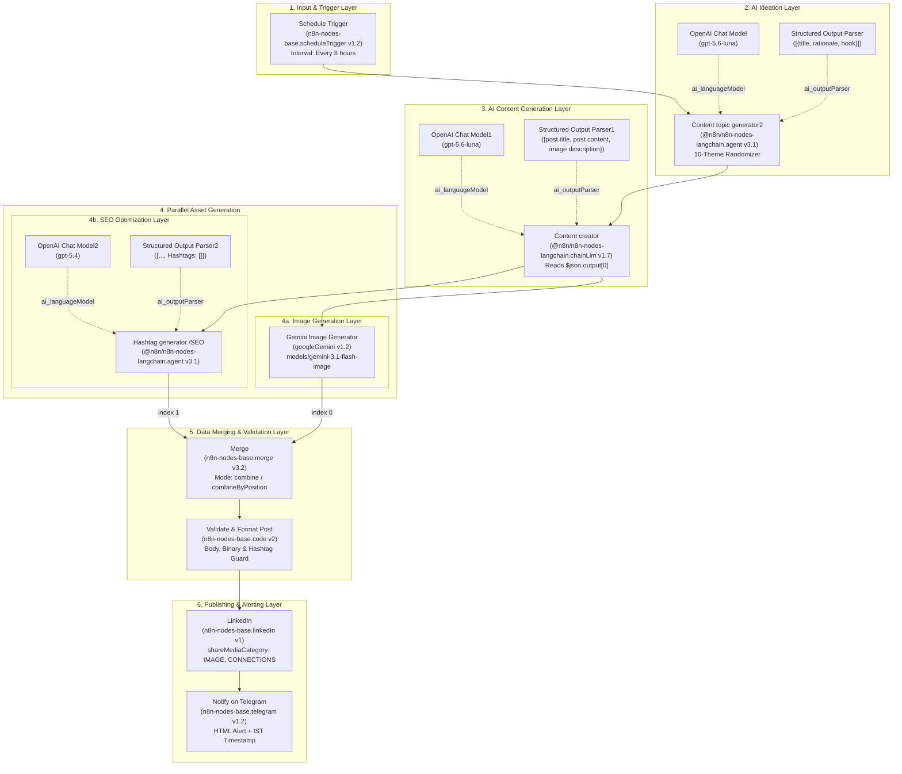

# System Architecture

This document describes the technical architecture of **AI-Powered LinkedIn Content Automation** as implemented in [`workflows/linkedin_content_automation.json`](../workflows/linkedin_content_automation.json), and clearly separates **implemented components** from **proposed enhancements**.

---

## High-Level Architecture Diagram

---

## Architectural Layers (Implemented)

### 1. Input Layer
- **Component:** `Schedule Trigger` (`n8n-nodes-base.scheduleTrigger` v1.2).
- **Behavior:** Fires automatically every 8 hours (`hoursInterval: 8`) with no external webhook or manual input required.
- **Note:** Currently, there is no external database or RSS/news feed input; dynamic context comes from `$now` and a 10-element theme array evaluated at runtime.

### 2. Processing & Ideation Layer
- **Component:** `Content topic generator2` (`@n8n/n8n-nodes-langchain.agent` v3.1) + `OpenAI Chat Model` (`gpt-5.6-luna`) + `Structured Output Parser`.
- **Behavior:** Uses an inline JavaScript expression (`Math.floor(Math.random() * 10)`) to pick one of 10 student/fresher career themes and instructs the agent to place that theme as the first item in a JSON array (`title`, `rationale`, `hook`).

### 3. AI Content Generation Layer
- **Component:** `Content creator` (`@n8n/n8n-nodes-langchain.chainLlm` v1.7) + `OpenAI Chat Model1` (`gpt-5.6-luna`) + `Structured Output Parser1`.
- **Behavior:** Consumes `$json.output[0]` from the topic generator and produces a LinkedIn post tailored to college students and fresh graduates. Explicitly instructs the model **not** to include hashtags in `post content` and to generate a separate `image description`.

### 4. Image Generation Layer (Parallel Branch A)
- **Component:** `Gemini Image Generator` (`@n8n/n8n-nodes-langchain.googleGemini` v1.2).
- **Behavior:** Receives `image description` and calls `models/gemini-3.1-flash-image` (`Nano Banana 2`) with `resource: "image"`. Because the workflow uses `settings.binaryMode: "separate"`, the generated image is attached as binary data on the item.

### 5. SEO Optimization Layer (Parallel Branch B)
- **Component:** `Hashtag generator /SEO` (`@n8n/n8n-nodes-langchain.agent` v3.1) + `OpenAI Chat Model2` (`gpt-5.4`) + `Structured Output Parser2`.
- **Behavior:** Evaluates `post title` and `post content` to generate 3–5 broad hashtags, 3–5 niche hashtags, and 1–2 trending hashtags, returning them under `output.Hashtags`.

### 6. Data Merging Layer
- **Component:** `Merge` (`n8n-nodes-base.merge` v3.2).
- **Behavior:** Synchronizes the two parallel branches (`Gemini Image Generator` on `index 0` and `Hashtag generator /SEO` on `index 1`) using `mode: "combine"` and `combineBy: "combineByPosition"`. This preserves the binary image from Branch A and the JSON `output.Hashtags` from Branch B in one unified n8n item.

### 7. Publishing & Notification Layer
- **Components:** `LinkedIn` (`n8n-nodes-base.linkedIn` v1) -> `Notify on Telegram` (`n8n-nodes-base.telegram` v1.2).
- **Behavior:**
  - `LinkedIn` references `$('Content creator').item.json.output['post content']`, strips any line starting with `#`, appends deduplicated hashtags from `$json.output.Hashtags`, attaches the merged binary image (`shareMediaCategory: "IMAGE"`), and publishes with `visibility: "PUBLIC"`.
  - `Notify on Telegram` formats an HTML message with the escaped post title, the LinkedIn post URL (`https://www.linkedin.com/feed/update/<urn>`), and the `Asia/Calcutta` (IST) timestamp.

---

## Implemented vs. Proposed Enhancements

| Capability | Current Status | Notes |
| :--- | :--- | :--- |
| Scheduled execution (8h) | **Implemented** | `Schedule Trigger` |
| 10-theme student/career ideation | **Implemented** | `Content topic generator2` |
| Structured JSON parsing (3 stages) | **Implemented** | `Structured Output Parser` 0, 1, 2 |
| Parallel Gemini image + SEO hashtags | **Implemented** | `Gemini Image Generator` & `Hashtag generator /SEO` |
| LinkedIn OAuth2 image publishing | **Implemented** | `LinkedIn` node |
| Telegram post-publish alert | **Implemented** | `Notify on Telegram` |
| Human-in-the-loop approval gate | **Proposed** | See [`future-enhancements.md`](future-enhancements.md) |
| Duplicate-topic memory / DB | **Proposed** | Not yet implemented |
| Error Trigger & retry/fallback logic | **Proposed** | Not yet implemented |
| Post analytics & multi-platform publishing | **Proposed** | Not yet implemented |
