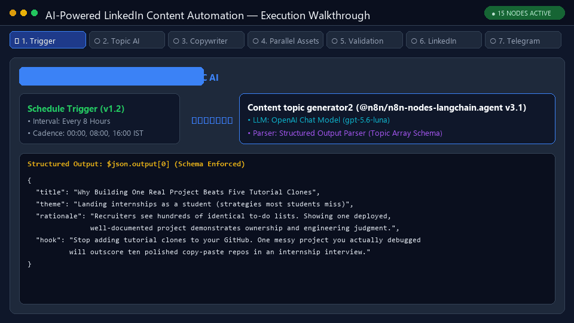

# Video Walkthrough & Presentation Guide

This guide provides a scene-by-scene recording script and visual storyboard to present **AI-Powered LinkedIn Content Automation** on GitHub, LinkedIn, YouTube, or during technical interviews.

---

## 1. Visual Demo Included in Repository

The repository includes an animated walkthrough demo rendered at 960x540 (16:9):

- **File Location:** [`assets/demo/workflow-walkthrough.gif`](../assets/demo/workflow-walkthrough.gif)
- **Embedded In:** [`README.md`](../README.md)
- **Generator Script:** [`scripts/generate_walkthrough_gif.py`](../scripts/generate_walkthrough_gif.py)

---

## 2. 90-Second Video Script (Scene-by-Scene)

Use this script if you record a screen recording with your voice (using [Loom](https://www.loom.com/), [OBS Studio](https://obsproject.com/), or [Screen Studio](https://www.screen.studio/)):

### **Scene 1 (0:00 - 0:15) — Hook & High-Level Overview**
- **Visual:** Show the full n8n canvas with all 15 nodes and 3 node groups (*Plan post topic*, *Create post assets*, *Publish and alert me*).
- **Spoken Script:**
  > *"Hey everyone! In this video, I'm walking you through my project: AI-Powered LinkedIn Content Automation. It's a 15-node pipeline built on n8n that automates the entire content lifecycle—from student-career topic ideation to structured copywriting, parallel Gemini visual generation, deterministic JavaScript validation, LinkedIn publishing, and instant Telegram delivery alerts."*

### **Scene 2 (0:15 - 0:30) — Stage 1: Topic Ideation & Schema Enforcement**
- **Visual:** Zoom into `Schedule Trigger` and `Content topic generator2`.
- **Spoken Script:**
  > *"Every 8 hours, a Schedule Trigger initiates the workflow. An OpenAI-backed LangChain agent rotates across 10 curated student career themes—like internships, placements, or AI tools. Instead of returning unstructured text, it's bound to a Structured Output Parser that enforces a strict JSON schema with title, rationale, and hook."*

### **Scene 3 (0:30 - 0:45) — Stage 2: Copywriting & Separation of Concerns**
- **Visual:** Click on `Content creator` (`chainLlm` node).
- **Spoken Script:**
  > *"Next, our Content Creator node expands the top topic into full LinkedIn copy with strong opening hooks and clean paragraphs. Crucially, we enforce a strict separation of concerns: the copywriter is forbidden from adding hashtags, and instead outputs an image description for our visual generator."*

### **Scene 4 (0:45 - 1:05) — Stage 3: Parallel Fan-Out (Gemini Image + SEO Hashtags)**
- **Visual:** Highlight the two parallel branches fanning out from `Content creator`.
- **Spoken Script:**
  > *"Here is where it gets interesting: execution fans out concurrently into two parallel branches. On Branch A, Google Gemini's image generation model creates a realistic visual asset, with automated retry policies. On Branch B, an OpenAI SEO agent categorizes broad and niche hashtags. Running these in parallel cuts total workflow latency in half."*

### **Scene 5 (1:05 - 1:20) — Stage 4: Merge & Deterministic Validation Gate**
- **Visual:** Zoom into `Merge` and `Validate & Format Post` (Code node).
- **Spoken Script:**
  > *"A Merge node joins the binary image and hashtag JSON by position. Then, our custom Code node acts as a deterministic pre-publish gate. It verifies that binary image data exists, strips accidental inline hashtags from the body, and deduplicates hashtags case-insensitively before sending anything to LinkedIn."*

### **Scene 6 (1:20 - 1:35) — Stage 5: Safe Publishing & Telegram Observability**
- **Visual:** Show `LinkedIn` node and `Notify on Telegram` response.
- **Spoken Script:**
  > *"Finally, the LinkedIn node publishes the image post with Connections visibility as a safe default. An instant Telegram bot alert notifies me with the live LinkedIn post URL and timestamp. The whole repository includes 14 automated offline tests and GitHub Actions CI. Thanks for watching!"*

---

## 3. How to Embed Video on GitHub

GitHub natively supports three ways to show videos:

### Option A: Animated GIF (Already Implemented)
Directly displays and loops in your `README.md` on both web and mobile without requiring any click:
```markdown

```

### Option B: Native GitHub MP4 Video Upload
1. Open any issue or discussion box on your GitHub repository (or edit `README.md` in the GitHub web editor).
2. Drag and drop your `.mp4` video file into the Markdown editor.
3. GitHub automatically uploads it to GitHub user-assets and gives you a link like:
   ```html
   https://github.com/user-attachments/assets/xxxx-xxxx
   ```
4. Paste that `<video src="...">` or markdown link directly into your `README.md`!

### Option C: Loom / YouTube Clickable Thumbnail
Add a preview thumbnail linking to your hosted video:
```markdown
[](https://www.youtube.com/watch?v=YOUR_VIDEO_ID)
```
